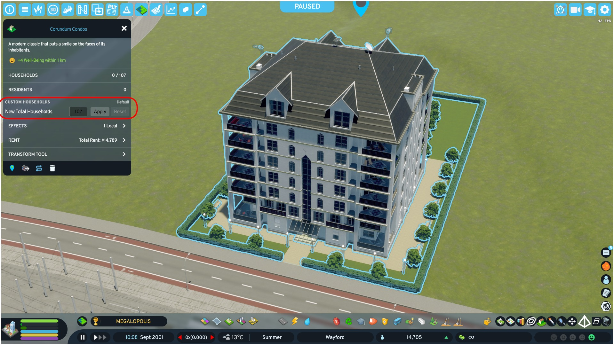

# CustomHouseholds

**Edit the household count of any residential building in Cities: Skylines II.**

Overrides apply to every identical building (same asset and level), persist across sessions

[**Paradox Mods page**](https://mods.paradoxplaza.com/mods/163911) · Game version **1.6.x**



## Features

- Set an absolute household count for any residential building you select
- The override applies to **every building with the same asset and level** — no need to edit them one by one
- Persists across sessions and saves, stored in a simple JSON file outside the savegame
- Native-style UI: a new section in the building's selected-info panel, matching the vanilla look
- **Reset** restores the original household count. The mod remembers the true original of each building, even after many edits and sessions
- Excess households are evicted when you reduce a building's capacity
- English and Portuguese (pt-BR) localization

## How to use

1. Select any residential building in your city.
2. In the selection panel, open the **CustomHouseholds** section, set the new household count and apply.
3. Use **Reset** to restore the original value at any time.

Additional tools are available in the mod's options (Main Menu → Options → Mods, or in-game):

- **Export building list** — writes every loaded residential asset (and its current household count) to `prefab_list.txt`
- **Reload overrides** — re-reads `overrides.json` without restarting the game
- **Clear all overrides** — restores every edited building to its original value

## How it works

- Overrides are keyed as `<prefab name>#<level>` (e.g. `EU_ResidentialMedium02_L5_2x2#5`) and stored in `overrides.json`
- `originals.json` archives the **first original** household count and RWH space multiplier seen for each building, so Reset always restores the real original — even after several edits, resets or game restarts
- When RWH is installed, the mod registers a compatible household override on the prefab so both mods cooperate instead of fighting each other
- Reducing capacity evicts the excess households through the game's own household eviction flow

## Data files

Everything lives in:

```
%USERPROFILE%\AppData\LocalLow\Colossal Order\Cities Skylines II\ModsData\CustomHouseholds\
```

| File | Purpose |
| --- | --- |
| `overrides.json` | Your overrides, keyed by `<prefab name>#<level>` |
| `originals.json` | Archived original values used by Reset |
| `prefab_list.txt` | All loaded residential assets with their current household counts (generated from the mod options) |
| `LEIA-ME.txt` | Quick guide (pt-BR) |

`overrides.json` accepts both shorthand and object formats:

```json
{
  "EU_ResidentialMedium02_L5_2x2#5": 10,
  "NA_Harris#5": { "households": 400 }
}
```

## Building from source

- Requires the **Cities: Skylines II modding toolchain** (installed by the game's mod editor)
- Set the `CSII_TOOLPATH` environment variable to the game's `.cache/Modding` folder
- Build with `dotnet build` — the toolchain automatically deploys the DLL to your local Mods folder
- Targets .NET Framework 4.8, as required by the game

## Known limitations

- Overrides are global per asset + level (they are not tied to a single city or save)
- Buildings that are not loaded in the city cannot be edited until their asset is present

## License

Released under the [MIT License](LICENSE) — free to use, modify and redistribute, as long as the copyright notice (creator credit) is kept.

## Links

- [Paradox Mods](https://mods.paradoxplaza.com/mods/163911)
